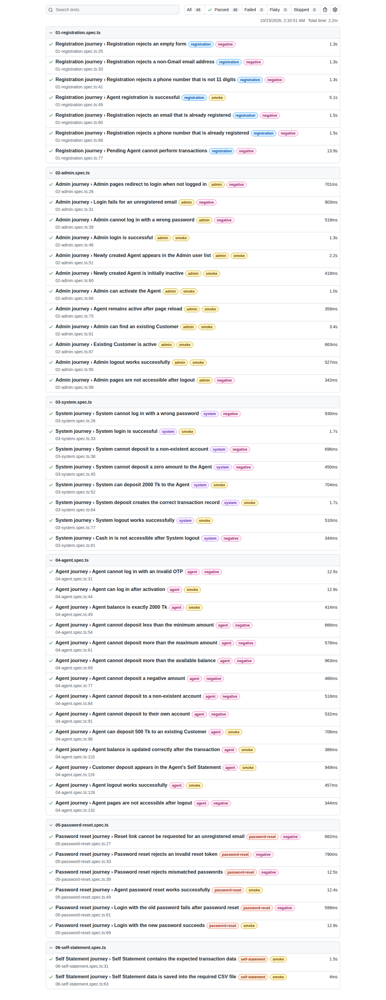
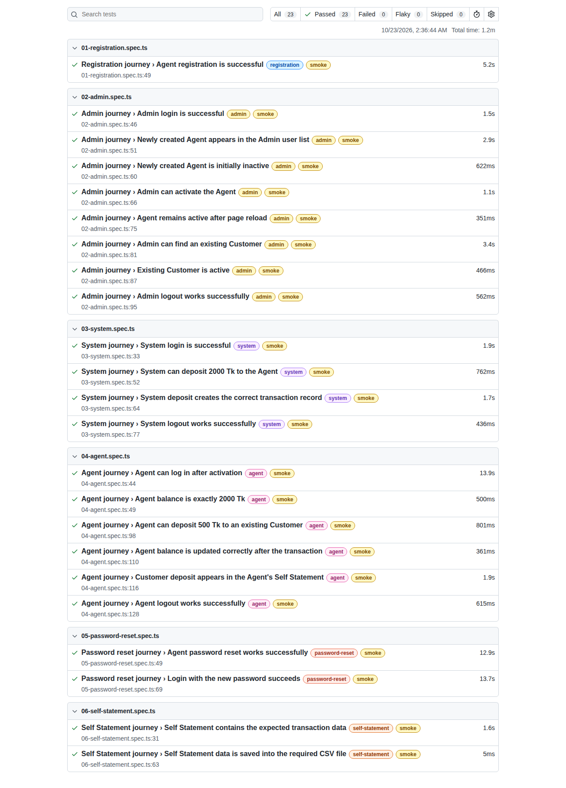

# DMoney Portal — Playwright E2E Automation

End-to-end automation of the [DMoney Portal](https://dmoneyportal.roadtocareer.net) agent journey with Playwright and TypeScript, using the Page Object Model.

A new Agent registers and an Admin activates the account. The System account deposits 2000 Tk to the Agent, and the Agent deposits 500 Tk to an existing Customer. The Agent then resets their password and exports the Self Statement to a CSV file. Every step has positive (`@smoke`) and negative (`@negative`) test cases.

## Table of contents

- [Tech stack](#tech-stack)
- [Project structure](#project-structure)
- [How the journey is organised](#how-the-journey-is-organised)
- [Setup](#setup)
- [Running the tests](#running-the-tests)
- [Test coverage](#test-coverage)
- [Automation video](#automation-video)
- [Regression Test Result](#regression-test-result)
- [SmokeTest Result](#smoketest-result)

## Tech stack

- [Playwright Test](https://playwright.dev) (TypeScript)
- [@faker-js/faker](https://fakerjs.dev) for test data
- Gmail API to read login OTPs and password-reset emails

## Project structure

```
├── data/users.json          # Admin / System credentials
├── pages/                   # Page objects (one per screen)
├── tests/                   # One spec file per journey, run in order
│   ├── 01-registration.spec.ts
│   ├── 02-admin.spec.ts
│   ├── 03-system.spec.ts
│   ├── 04-agent.spec.ts
│   ├── 05-password-reset.spec.ts
│   └── 06-self-statement.spec.ts
├── utils/                   # Test data, Gmail OTP reader, CSV writer, journey state, suite tags
├── output/                  # Generated self_statement_<YYYY-MM-DD>.csv (git-ignored)
├── .state/                  # The new agent and IDs handed between journeys (git-ignored)
├── docs/                    # README video and screenshots
└── playwright.config.ts
```

## How the journey is organised

Each spec file is a Playwright **project**. The projects are chained with `dependencies`, so they always run in order: registration → admin → system → agent → password-reset → self-statement. Data such as the new agent's details, user IDs and transaction IDs is passed from one journey to the next through `.state/journey.json`. That file is git-ignored because the agent's email is an alias of the Gmail inbox.

In each journey, the negative cases run first and then the positive ones. A negative case that needs data from a positive one runs after it, for example the duplicate-email check after a successful registration.

## Setup

1. Install dependencies and the browser:

   ```bash
   npm install
   npx playwright install chromium
   ```

2. Copy `.env.example` to `.env` and fill in the Gmail details. New agents are registered with a `+alias` of this inbox, so their OTP and reset emails arrive there.

   | Variable | Purpose |
   | --- | --- |
   | `GMAIL_ADDRESS` | Inbox that receives the OTP and password-reset emails |
   | `GMAIL_ACCESS_TOKEN` | OAuth token with the `gmail.readonly` scope (expires after about 1 hour) |
   | `GMAIL_CLIENT_ID`, `GMAIL_CLIENT_SECRET`, `GMAIL_REFRESH_TOKEN` | Optional: if all three are set, a fresh access token is created on every run |

## Running the tests

| Command | What it runs |
| --- | --- |
| `npm test` | Full regression suite (positive + negative), headed |
| `npm run test:smoke` | Smoke suite: positive cases only |
| `npm run test:negative` | Negative cases only |
| `npm run test:record` | Full suite with every journey recorded to `videos/` |
| `npm run report` | Open the last HTML report |

Add `HEADLESS=true` to any command to run without a visible browser. Suites are filtered with the `TAG` environment variable rather than `--grep`, because `--grep` doesn't apply to dependency projects.

## Test coverage

**Positive (`@smoke`)**: Agent registration · Agent initially inactive · Admin login · Agent appears in the Admin user list · Admin activates the Agent (including the success message) · Agent stays active after reload · System login · System deposits 2000 Tk · System deposit transaction record · Agent login after activation · Agent balance is exactly 2000 Tk · Agent deposits 500 Tk to a Customer · Agent balance after the transaction · Deposit appears in the Self Statement · Agent logout · Password reset · Login with the new password · Self Statement data · CSV export.

**Negative (`@negative`)**: empty registration form · non-Gmail registration · invalid phone number · duplicate email · duplicate phone number · pending agent cannot transact · unregistered email login · Admin and System wrong password · invalid OTP · protected pages before login and after logout · cash in to a non-existent account · cash in to the Agent's own account · zero amount (`Amount is required.`) · negative amount · amount below 10 Tk or above 10000 Tk · amount above the balance (`Insufficient balance`) · reset for an unregistered email · invalid reset token · mismatched passwords · login with the old password after reset.

## Automation video

Full regression run in headed mode: 

https://github.com/user-attachments/assets/2bf45fad-58a5-4a9a-b70d-d5512e991583


## Regression Test Result

All 49 tests (positive + negative):



## SmokeTest Result

23 positive tests:


